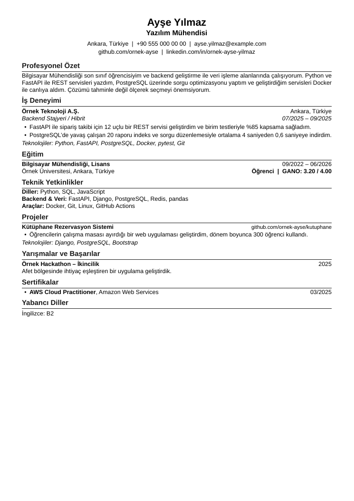

# cv-hazirla

Adayla soru-cevap yaparak ATS uyumlu CV hazırlayan bir yapay zekâ ajanı skill'i.
Claude Code için yazıldı. `SKILL.md` biçimini okuyan diğer ajanlarda da (Codex, Gemini CLI vb.) kullanılabilir.

> **English summary.** An agent skill that interviews a candidate and builds an ATS-friendly,
> single-column LaTeX/PDF résumé. It finds missing or invalid fields (e.g. an internship without
> dates, bullets without measurable results), asks the candidate only what is missing, never
> invents facts, and verifies the final PDF the way an ATS reads it. Turkish and English output.

## Ne yapar

Çoğu CV aracı sadece bir şablonu doldurur. Bu skill önce eksikleri bulur, sonra adaya sorar:

```
[zorunlu] deneyim[0].baslangic   Örnek A.Ş. (Backend Stajyeri): başlangıç ve bitiş tarihi nedir? (AA/YYYY, sürüyorsa bitiş için 'devam')
[hata   ] deneyim[1].bitis       Kulüp (Başkan): bitiş (03/2023) başlangıçtan (09/2023) önce. Hangisi yanlış?
[oneri  ] deneyim[0].maddeler    Örnek A.Ş. (Backend Stajyeri): ölçülebilir bir sonuç var mı? Yoksa 'yok' de, uydurmayız.
```

Akış:

1. Adayın mevcut CV'sini (varsa) okur ve `profil.json`'a aktarır.
2. `eksik.py` eksik ve hatalı alanları bulur, her biri için hazır soru üretir.
3. Ajan adaya turda en çok 5 soru sorar, cevapları işler, eksik kalmayana kadar tekrarlar.
4. Özeti ve madde cümlelerini adayın verdiği bilgiden yazar, onayını alır.
5. (İsteğe bağlı) Bir iş ilanına göre unvanı, özeti ve yetkinlik sırasını ayarlar.
6. `render.py` LaTeX CV üretir, LuaLaTeX ile PDF'e derlenir.
7. `ats_kontrol.py` PDF'i ATS gibi düz metne çevirip denetler: metin çıkıyor mu, ad/e-posta/telefon
   okunuyor mu, Türkçe karakter bozuluyor mu, ligatür ya da ikon fontu var mı, sayfa sınırı,
   ilan anahtar kelimelerinin kapsaması.

Kesin kural: tarih, sayı, unvan, teknoloji ya da sonuç adaydan gelmediyse CV'ye girmez.



## Kurulum

Gerekenler: Python 3.10+, LuaLaTeX (TeX Live), poppler-utils, bir sans-serif yazı tipi (varsayılan Liberation Sans).

```bash
# Ubuntu / Debian
sudo apt install texlive-luatex texlive-latex-extra texlive-lang-european poppler-utils fonts-liberation
# macOS
brew install --cask mactex-no-gui && brew install poppler
```

Skill'i Claude Code'a ekle:

```bash
git clone https://github.com/Ugurhandasdemir/cv-hazirla-skill.git
# bütün projelerde kullanmak için
ln -s "$PWD/cv-hazirla-skill/skills/cv-hazirla" ~/.claude/skills/cv-hazirla
# ya da yalnız bir projede
mkdir -p .claude/skills && cp -r cv-hazirla-skill/skills/cv-hazirla .claude/skills/
```

Sonra Claude Code'da: `CV hazırlayalım` ya da `/cv-hazirla`.

## Scriptleri elle kullanmak

Scriptler yalnız Python standart kütüphanesi kullanır, ajansız da çalışır.

```bash
S=skills/cv-hazirla
cp $S/examples/bos-profil.json profil.json          # ya da ornek-profil.json'dan başla
python3 $S/scripts/eksik.py profil.json             # eksikler ve sorular
python3 $S/scripts/render.py profil.json -o cv.tex  # eksik varsa üretmez
lualatex cv.tex && lualatex cv.tex
python3 $S/scripts/ats_kontrol.py cv.pdf --profil profil.json --anahtar "Python,Docker,REST API"
```

## profil.json

Şemanın tamamı için `skills/cv-hazirla/examples/ornek-profil.json` dosyasına bak. Özet:

| Alan | İçerik |
|---|---|
| `dil` | `tr` ya da `en`, bölüm başlıklarını belirler |
| `kisisel` | `ad_soyad`, `unvan`, `sehir`, `telefon`, `eposta`, `linkedin`, `github`, `web` |
| `ozet` | 3-4 cümlelik profesyonel özet |
| `bolum_sirasi` | Bölümlerin sırası. Listede olmayan bölüm basılmaz |
| `deneyim` | `tur` (is, staj, yari_zamanli, gonullu), `kurum`, `sehir`, `pozisyon`, `calisma_sekli`, `baslangic`, `bitis`, `maddeler`, `teknolojiler` |
| `egitim` | `okul`, `bolum`, `derece`, `sehir`, `baslangic`, `bitis`, `durum` (mezun, ogrenci), `gano` |
| `projeler` | `baslik`, `link`, `odul`, `maddeler`, `teknolojiler` |
| `yetkinlikler` | `kategori`, `ogeler` |
| `basarilar` | `baslik`, `yil`, `aciklama` |
| `sertifikalar` | `ad`, `kurum`, `tarih` |
| `diller` | `dil`, `seviye` |
| `topluluk` | `deneyim` ile aynı yapı (kulüp, takım, gönüllülük) |

Tarih biçimi her yerde `AA/YYYY`. Ay bilinmiyorsa `YYYY` kabul edilir ama öneri olarak sorulur.
Süren işler için bitiş `devam`.

## Test

```bash
pip install pytest
pytest -q
```

Testler yalnız mutlu yolu değil, kenar durumları da kapsar: geçersiz ve ters sıralı tarihler,
LaTeX özel karakterleri (`& % $ # _ { } ~ ^ \`), boş profil, bozuk JSON, Türkçe karakterin PDF'te
bozulması, ligatür ve ikon fontu tespiti, `Java` ile `JavaScript` gibi anahtar kelime sınırları.
LuaLaTeX kuruluysa uçtan uca derleme testi de çalışır.

## Lisans

MIT
